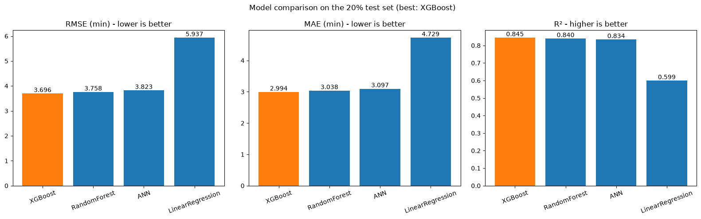
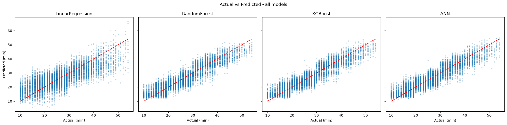
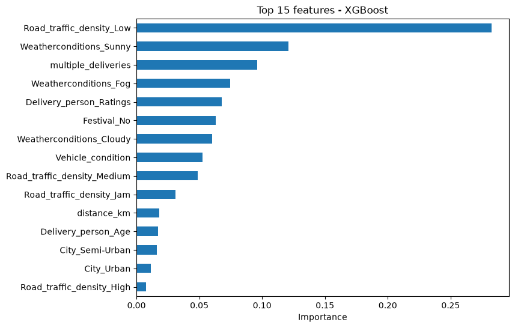

# 🛵 Delivery Time Estimation — ML Regression System

> Predicting food delivery duration (in minutes) from route, traffic, courier and order characteristics using traditional ML and a neural network.

**Best model: XGBoost — RMSE 3.70 min · MAE 2.99 min · R² 0.845** (on a held-out 20% test set)

---

## 📌 Table of Contents
1. [Problem Statement](#-problem-statement)
2. [Use Case](#-use-case-delivery-time-estimation)
3. [Objectives](#-objectives)
4. [Dataset](#-dataset)
5. [System Design](#️-system-design)
6. [Tech Stack](#-tech-stack)
7. [Project Structure](#-project-structure)
8. [How to Run](#-how-to-run)
9. [Results](#-results)
10. [Team](#-team)

---

## ❓ Problem Statement

Many industries rely on accurate numerical predictions to support decision-making. Regression models play a central role in forecasting continuous values such as sales, customer spend, equipment failure patterns and delivery times. Building an effective regression solution requires clean data, robust modeling, hyperparameter optimization and clear evaluation.

In food and parcel delivery, an inaccurate **Estimated Time of Arrival (ETA)** directly hurts the business:

- **Customers** lose trust when orders arrive later than promised.
- **Operations teams** cannot plan courier allocation or batch orders efficiently.
- **Restaurants** cannot time food preparation to courier arrival.

A simple rule such as *"distance ÷ average speed"* ignores traffic, weather, courier experience, multiple orders and festival rush, so it is frequently wrong.

**Goal:** build an end-to-end Machine Learning Regression System that learns from historical deliveries and predicts the delivery time of a new order.

---

## 🎯 Use Case: Delivery Time Estimation

We chose **Option C — Delivery Time Estimation** from the hackathon use cases.

| Item | Description |
|---|---|
| **Business question** | *"How many minutes will this order take to deliver?"* |
| **Prediction type** | Regression (continuous target) |
| **Target variable** | `Time_taken(min)` → cleaned to `Time_taken_min` |
| **Inputs** | Route (pickup & drop location, city), traffic, weather, courier profile, vehicle, order type, festival flag, order time |
| **Consumers** | Customer app (ETA display), dispatch team (courier assignment), analysts (delay drivers) |

### Example (real output of our model)
```
Input : 6.2 km, High traffic, Cloudy, motorcycle, rating 4.7, 1 extra order, no festival, 8:15 PM
Output: Estimated delivery time ≈ 30.3 minutes
```

---

## ✅ Objectives

- Ingest and validate structured delivery data (CSV)
- Clean data: missing values, inconsistent text, invalid values and outliers
- Perform EDA and correlation analysis to identify key drivers of delay
- Engineer domain features (distance, preparation time, order hour, weekday)
- Train and compare **traditional ML models** and an **Artificial Neural Network**
- Tune hyperparameters with **RandomizedSearchCV** and validate with **5-Fold Cross Validation**
- Evaluate using **RMSE, MAE and R²**, with residual and feature-importance plots
- Serve the best model through a **FastAPI REST API** and a **Streamlit UI**

---

## 📊 Dataset

**Source:** [Food Delivery Dataset — Kaggle (Gaurav Malik)](https://www.kaggle.com/datasets/gauravmalik26/food-delivery-dataset)
**Domain:** Food deliveries across Indian cities

| File in Kaggle zip | Saved as | Rows | Has target? | Used for |
|---|---|---|---|---|
| `train.csv` | `data/raw/dataset.csv` | 45,593 | ✅ | Training + evaluation (80/20 split) |
| `test.csv` | `data/raw/test.csv` | 11,399 | ❌ | Batch predictions on unseen orders |

> Kaggle's `test.csv` has no labels, so model accuracy is measured on a held-out 20% of `dataset.csv`.

### Column Description

| Group | Column | Description | Type |
|---|---|---|---|
| **Identifiers** | `ID` | Unique order ID (dropped) | string |
| | `Delivery_person_ID` | Courier ID (dropped) | string |
| **Courier** | `Delivery_person_Age` | Age of the courier | numeric |
| | `Delivery_person_Ratings` | Average customer rating (1–5) | numeric |
| | `Vehicle_condition` | 0–3; in the data, 0 has the slowest deliveries (30.1 min avg vs 24.4 for 1–2) | ordinal |
| | `Type_of_vehicle` | motorcycle / scooter / electric_scooter / bicycle | categorical |
| | `multiple_deliveries` | Number of orders carried together (0–3) | numeric |
| **Route** | `Restaurant_latitude`, `Restaurant_longitude` | Pickup location | numeric |
| | `Delivery_location_latitude`, `Delivery_location_longitude` | Drop location | numeric |
| | `City` | Metropolitian / Urban / Semi-Urban (spelling as in the dataset) | categorical |
| **Time** | `Order_Date` | Date of the order (DD-MM-YYYY) | date |
| | `Time_Orderd` | Time the order was placed | time |
| | `Time_Order_picked` | Time the courier picked up the order | time |
| **Conditions** | `Weatherconditions` | Sunny / Cloudy / Fog / Stormy / Sandstorms / Windy | categorical |
| | `Road_traffic_density` | Low / Medium / High / Jam | categorical |
| | `Festival` | Yes / No | binary |
| **Package** | `Type_of_order` | Snack / Meal / Drinks / Buffet | categorical |
| **Target** | `Time_taken(min)` | Delivery duration in minutes (10–54) | numeric |

### Data Quality Issues and How We Handled Them

| Issue | Example | Rows | Handling |
|---|---|---|---|
| Target stored as text | `"(min) 24"` | all | Strip prefix → integer |
| Missing values stored as text | `"NaN "` | 8 columns | Convert to real `NaN` |
| Extra whitespace / prefixes | `"High "`, `"conditions Sunny"` | all text columns | Strip spaces and prefix |
| Numbers stored as text | Age, Ratings | — | `pd.to_numeric(errors="coerce")` |
| Restaurant at (0, 0) | lat = 0, long = 0 | 3,640 | **Dropped** (not a real location) |
| Negative coordinates | `-22.74` | 431 | Absolute value (India is +lat, +long) |
| Invalid ratings / ages | Rating = 6, Age = 15 | 81 | **Dropped** |
| Missing order time | `Time_Orderd = NaN` | 1,519 | **Dropped** (prep time can't be computed) |
| Other missing values | Age, rating, weather, traffic, city, festival, multiple deliveries | — | Median (numbers) / mode (categories) |

**After cleaning:** 45,593 → **40,353 rows**, **0 missing values**.

### Engineered Features

| Feature | Logic | Why it matters |
|---|---|---|
| `distance_km` | Haversine distance between restaurant and customer (1.5–21 km) | Core driver of travel time |
| `prep_time_min` | `Time_Order_picked − Time_Orderd` (handles orders crossing midnight) | Restaurant preparation delay |
| `order_hour` | Hour from `Time_Orderd` | Time-of-day effect |
| `order_weekday` | Day of week from `Order_Date` (0 = Monday) | Weekly demand pattern |

Final model input: **14 features** (8 numeric + 6 categorical) → **30 columns** after one-hot encoding.

### What Drives Delivery Time (from the data)

| Factor | Average delivery time |
|---|---|
| Traffic: Low → Jam | 21.3 → 31.2 min |
| Multiple deliveries: 0 → 3 | 22.9 → 47.9 min |
| Festival: No → Yes | 25.9 → 45.5 min |
| City: Urban → Semi-Urban | 23.0 → 49.7 min |

### Conceptual Model
```
Delivery time ≈ Restaurant prep time
              + Travel time (distance × traffic × weather × vehicle)
              + Delays (multiple orders, festival, courier rating/experience)
```

---

## 🏗️ System Design

### High-Level Architecture

```
┌────────────────┐   ┌────────────────────┐   ┌───────────────────────┐
│ Data Ingestion │──►│ Data Preprocessing │──►│ Feature Engineering   │
│ • CSV load     │   │ • clean text / NaN │   │ • distance_km         │
│ • schema check │   │ • invalid values   │   │ • prep_time_min       │
└────────────────┘   │ • outlier removal  │   │ • order_hour, weekday │
                     └────────────────────┘   │ • EDA charts          │
   PHASE 1                                    └──────────┬────────────┘
   data/processed/cleaned_data.csv, featured_data.csv    │
                                                         ▼
┌───────────────────────────────────────────────────────────────────┐
│ PHASE 2 — Model Training & Optimization                           │
│   80/20 split → ColumnTransformer (StandardScaler + OneHotEncoder)│
│   fitted on TRAIN only → models/preprocessor.pkl                  │
│   Models: Linear Regression · Random Forest · XGBoost · ANN (Keras)│
│   Tuning: RandomizedSearchCV (RF, XGB) · config search (ANN)      │
│   Validation: 5-Fold Cross Validation                             │
└──────────────────────────────┬────────────────────────────────────┘
                               ▼
┌───────────────────────────────────────────────────────────────────┐
│ Evaluation: RMSE · MAE · R² · residual plot · actual vs predicted │
│ · feature importance · model comparison                           │
│ → results/metrics.json, results/model_comparison.csv, images/     │
└──────────────────────────────┬────────────────────────────────────┘
                               ▼
              models/best_model.pkl  (lowest RMSE → XGBoost)
                               │
                       src/predict.py  (same cleaning + features)
                               │
        ┌──────────────────────┼──────────────────────┐
        ▼                      ▼                      ▼
  Streamlit UI (app.py)   FastAPI (api.py)     Batch (predict_test.py)
  • order form → ETA      • GET  /             • test.csv → 11,399
  • CSV upload            • POST /predict        predictions
  • model performance     • /docs (Swagger)    • results/predictions.csv
                        PHASE 3
```

### Handling New Orders

Training **drops** bad rows, but a real order can't be dropped. `src/predict.py` therefore **fills** problems with the training data's medians/modes: missing order time → hour from pickup time + median prep time; restaurant at (0, 0) → median distance; rating > 5 or age < 18 → treated as missing; unseen categories (e.g. `bicycle`) are ignored by the encoder.

---

## 🧰 Tech Stack

| Layer | Tools |
|---|---|
| Language | Python 3 |
| Data | pandas, NumPy |
| Charts | Matplotlib, Seaborn |
| Machine learning | scikit-learn, XGBoost |
| Neural network | TensorFlow / Keras |
| Model saving | joblib (`.pkl`), Keras (`.keras`) |
| UI / API | Streamlit, FastAPI + Uvicorn |
| Teamwork | GitHub, VS Code, Jupyter |

---

## 📁 Project Structure

```
Food-Delivery-Estimate-Time-Prediction/
│
├── data/
│   ├── raw/
│   │   ├── dataset.csv              ← Kaggle train.csv (45,593 rows)
│   │   └── test.csv                 ← Kaggle test.csv (no target)
│   └── processed/
│       ├── cleaned_data.csv         ← after cleaning (40,353 × 20)
│       └── featured_data.csv        ← model input (40,353 × 15)
│
├── src/
│   ├── data_loader.py               ← load, schema check, fix text
│   ├── preprocessing.py             ← outliers + missing values
│   ├── feature_engineering.py       ← distance + time features
│   ├── eda.py                       ← EDA charts
│   ├── model_prep.py                ← split + encoding + scaling
│   ├── train_ml.py                  ← Linear Regression, Random Forest, XGBoost
│   ├── train_ann.py                 ← Keras ANN + tuning
│   ├── evaluate.py                  ← RMSE/MAE/R², K-Fold CV, comparison
│   ├── plots.py                     ← evaluation + comparison charts
│   └── predict.py                   ← shared prediction logic for app/API/batch
│
├── models/
│   ├── preprocessor.pkl             ← fitted ColumnTransformer
│   ├── best_model.pkl               ← XGBoost (best)
│   └── ann_model.keras              ← Keras ANN
│
├── results/
│   ├── metrics.json                 ← all model scores
│   ├── model_comparison.csv
│   ├── best_model.json              ← name + path of the best model
│   └── predictions.csv              ← test.csv predictions (ID, minutes)
│
├── images/                          ← 9 charts (EDA + evaluation)
│
├── main.py                          ← runs Phase 1 + Phase 2
├── run_phase1.py                    ← load → clean → features
├── run_phase2.py                    ← train → evaluate → save best
├── app.py                           ← Streamlit UI
├── api.py                           ← FastAPI service
├── predict_test.py                  ← batch predictions for test.csv
├── requirements.txt
└── README.MD
```

---

## 🚀 How to Run

### 1. Setup (once)

```powershell
git clone https://github.com/ti-ger11/Food-Delivery-Estimate-Time-Prediction.git
cd Food-Delivery-Estimate-Time-Prediction
python -m venv venv
.\venv\Scripts\Activate.ps1
pip install -r requirements.txt
```

If PowerShell blocks activation, run once: `Set-ExecutionPolicy -Scope CurrentUser RemoteSigned`

### 2. Train (Phase 1 + 2, about 7 minutes)

```powershell
python main.py              # everything
python main.py --phase 1    # only cleaning + features
python main.py --phase 2    # only training + evaluation
```

### 3. Predict

```powershell
streamlit run app.py        # UI  → http://localhost:8501
uvicorn api:app --reload    # API → http://127.0.0.1:8000/docs
python predict_test.py      # test.csv → results/predictions.csv
```

### Example API call

```http
POST /predict
{
  "Delivery_person_Age": 28, "Delivery_person_Ratings": 4.6,
  "Restaurant_latitude": 12.914264, "Restaurant_longitude": 77.6784,
  "Delivery_location_latitude": 12.994264, "Delivery_location_longitude": 77.7584,
  "Order_Date": "25-03-2022", "Time_Orderd": "19:45", "Time_Order_picked": "19:55",
  "Weatherconditions": "Sunny", "Road_traffic_density": "Jam", "Vehicle_condition": 2,
  "Type_of_order": "Meal", "Type_of_vehicle": "motorcycle", "multiple_deliveries": 1,
  "Festival": "No", "City": "Metropolitian"
}
```
Response:
```json
{"predicted_minutes": 18.3, "model": "XGBoost"}
```

---

## 📈 Results

### Model Comparison (20% held-out test set, 8,071 orders)

| Rank | Model | RMSE (min) | MAE (min) | R² | 5-Fold CV RMSE |
|---|---|---|---|---|---|
| 🥇 | **XGBoost** | **3.696** | **2.994** | **0.845** | 3.758 ± 0.034 |
| 🥈 | Random Forest | 3.758 | 3.038 | 0.840 | 3.820 ± 0.032 |
| 🥉 | ANN (Keras, 128 → 64 → 1) | 3.823 | 3.097 | 0.834 | — (validation split) |
| 4 | Linear Regression (baseline) | 5.937 | 4.729 | 0.599 | 5.953 ± 0.035 |





### Tuned Hyperparameters

| Model | Best settings |
|---|---|
| Random Forest | `n_estimators=200, max_depth=15, min_samples_split=2, min_samples_leaf=1` |
| XGBoost | `n_estimators=200, max_depth=8, learning_rate=0.05, subsample=1.0, colsample_bytree=1.0` |
| ANN | Dense(128, ReLU, He init) → Dropout(0.2) → Dense(64, ReLU) → Dense(1); Adam lr=0.001, MSE loss, early stopping (patience 5) |

### Key Findings

- **XGBoost wins** — boosting corrects earlier trees' errors step by step, edging out Random Forest.
- **ANN is close but not first** — on tabular data, tree models usually match or beat neural networks.
- **Linear Regression is far behind (R² 0.60)** — delivery time is non-linear: traffic, weather and distance interact.
- **No overfitting** — CV RMSE (3.76) ≈ test RMSE (3.70) with very low spread (± 0.03).
- **No data leakage** — encoder and scaler are fitted on the training split only.
- **Top drivers:** traffic density, weather, multiple deliveries, courier rating, festival.



### Predictions on Unseen Orders (`test.csv`)

All **11,399** orders predicted with no gaps → `results/predictions.csv` (average 26.1 min, range 11.8–53.9 min).

---

## 👥 Team

**Team Neural Storm**

| Member | Phase 1 | Phase 2 | Phase 3 |
|---|---|---|---|
| **Chandrakant Suman** | Data loading, schema check, text cleaning, EDA | Train/test split, encoding, evaluation, K-Fold CV, `main.py` | Streamlit UI (`app.py`) |
| **Om Singh Bisen** | Missing values, outlier removal | Linear Regression, Random Forest, XGBoost + tuning | Batch predictions (`predict_test.py`), README |
| **Rshishabh Yadav** | Feature engineering (distance, time features) | Keras ANN + tuning, evaluation charts | Prediction module (`src/predict.py`), FastAPI (`api.py`) |
